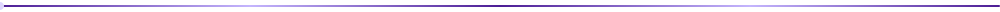
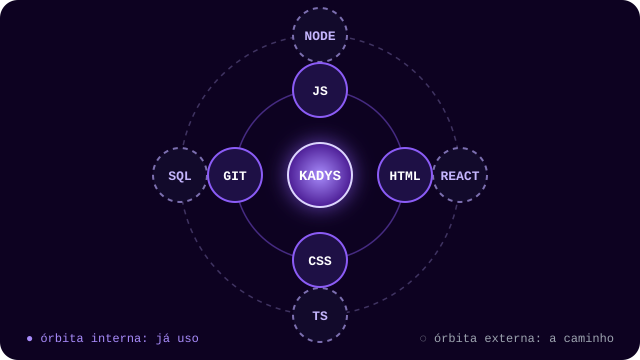

<div align="center">
  
</div>

<div align="center">
  
  
  
  
</div>



## `// sobre`

```js
const kadys = {
  nome: "Kadys Naan",
  alias: "z0ldyck.404",
  status: "Estagiário de TI",
  graduacao: "Engenharia de Software",
  foco: ["lógica", "estruturas de dados", "arquitetura", "boas práticas"],
  horasVagas: "gamer 🎮",
  mantra: "consistência > intensidade",
};
```


## `// agora`

<div align="center">
  
</div>


## `// stack`

<div align="center">
  
</div>


## `// roadmap`

- [x] Lógica e JavaScript (revisando e praticando)
- [x] Git e GitHub: primeiro commit e primeiro push
- [ ] APIs REST, `fetch` e `async/await`
- [ ] Node.js + Express
- [ ] React + TypeScript
- [ ] PostgreSQL e modelagem de dados
- [ ] Primeiro projeto fullstack completo

> Cada `[ ]` vira `[x]` quando eu fechar de verdade, com código escrito.


## `// atividade`

<div align="center">
  
</div>

<div align="center">
  
</div>

<div align="center">
  
</div>


## `// contato`

<div align="center">
  <a href="https://www.linkedin.com/in/kadysnaan">
    
  </a>
  <a href="https://github.com/kadysnaan">
    
  </a>
</div>

<br>

<div align="center">

`z0ldyck.404` ⚡ _"Se deixarem, o pai programa o próximo Ultron"_

</div>

<div align="center">
  
</div>
